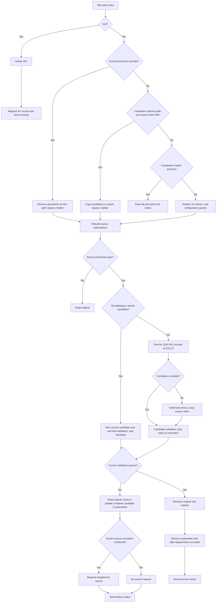

# Tdarr Arc AV1 Flow

V15 is a single-pass Tdarr flow for encoding eligible video with Intel Arc Quick Sync AV1. It applies audio and subtitle policies, validates the source and candidate, and only replaces the library file after the candidate passes its checks.

## At a glance



For the full node-by-node view, see [the flow diagram](docs/architecture/flow-diagram.md).

## Processing policy

| Area | V15 behavior |
| --- | --- |
| Video encode | One Arc QSV AV1 attempt for each eligible video, using global ICQ 22. HDR sources whose mastering green-y falls in the documented Intel QSV clamp range route directly to one software SVT-AV1 encode at CRF 28; strict output HDR checks still apply. The Arc device defaults to `/dev/dri/renderD129`. |
| Larger encode result | The flow discards the encode attempt and tries a seek-healing remux of the original video. For Dolby Vision or HDR10+ sources, this preserves the source dynamic HDR video instead of producing the HDR10 conversion; validation compares source and output dynamic-metadata frame counts and static HDR metadata. The remux replaces the source only after full validation. |
| Source scan | Header-only pixel/depth, aspect-ratio, Arc device access, ICQ, 12-bit, and applicable HDR color checks run first. If FFprobe omits source SAR, MediaInfo must report square pixels; the candidate must still report 1:1 SAR with unchanged dimensions. Supported Dolby Vision routes validate required Level 6 metadata before the full CPU frame, color/HDR, timestamp, and corruption scan. The scan stops on a decisive failure; eligible clean sources are still scanned end to end. Retained audio is checked and decoded before the encode. |
| Candidate checks | Full frame/timeline, stream/color/HDR/subtitle, and strict A/V decode checks guard replacement. Supported video uses Arc QSV verification; known libva initialization info is ignored only when QSV exits successfully, while other diagnostics trigger one full software decode retry. Other codecs use software directly. Results distinguish passed, recovered, rejected, and inconclusive checks. |
| Failed candidate | A complete candidate that fails final validation is retained in quarantine. On a retry, compatible source video and retained-audio precheck evidence can be reused; current candidate validation still runs. |
| Audio | Keep English, Japanese, Spanish, Italian, and undetermined tracks. Preserve selected audio streams by copy, then run timing and decode checks. |
| Subtitles | Preserve styled ASS/SSA and all source attachments when a retained ASS/SSA track is copied. Precheck packet timing; if predicted repair exceeds 0.5 seconds, attempt to reconstruct an ASS script for chronological muxing. Validate candidate packet payloads and timing, attachment hashes and metadata, and PGS segments. Muxing uses a ten-second interleave bound. |
| Notifications | Send success/failure notices, an info notice for already-processed files, and a warning when an ISO is deleted and an Arr rescan is requested. |
| Arr searches | Route a targeted search only when the flow confirms known source corruption. A queued search does not guarantee a replacement download. |

## Video formats and HDR

The tested SDR paths include H.264, HEVC, AV1, VP8/VP9, MPEG-2, MPEG-4 Part 2, ProRes, and FFV1 samples. The flow accepts listed planar YUV 4:2:0, 4:2:2, and 4:4:4 formats up to 12-bit when a supported color path is established. Unsupported pixel formats, RGB/alpha, interlaced video, and unverified color combinations are held with the original retained.

HDR handling is deliberately signal-aware:

- Verified HDR10 and HLG use their guarded encode paths.
- HDR10+ is converted using its static HDR10 base; dynamic HDR10+ metadata is not retained.
- Verified Dolby Vision Profile 7 HDR10-compatible base layers and Profile 8.1 paths produce HDR10. A Profile 7 plus HDR10+ hybrid is accepted only with verified BL/EL/RPU presence and compatibility ID 6; Profile 8.1 plus HDR10+ still requires its verified single-layer HDR10 base. Dolby Vision and HDR10+ dynamic metadata, and Profile 7 enhancement-layer detail, are discarded; static HDR10 metadata is validated before replacement.
- For HDR10, stream-sourced MediaInfo mastering and content-light fields can fill missing FFprobe side data when their values parse exactly and the primaries label is recognized. Any existing FFprobe values must agree, and the encoded candidate must still match the completed source record; unknown or conflicting metadata is not guessed.
- A decoded CLL pair of `0/0` means unspecified; the flow does not treat it as conflicting with CLL values taken from Dolby Level 6. When base CLL is absent/`0,0` and Dolby Level 6 mastering luminance differs from the verified HDR10 base, the flow logs a warning, omits CLL (`0/0` placeholder stripped), and encodes the verified HDR10 base without borrowing conflicting Level 6 CLL.
- Verified Dolby Vision Profile 5 (`dvhe.05`, full-range 10-bit HEVC IPT-PQ-c2 without HDR10 base tags, compatibility ID 0, per-frame RPU) converts via `libplacebo` (`apply_dolbyvision=true` on Intel Vulkan ICD `/usr/share/vulkan/icd.d/intel_icd.json`) and RPU Level 6/Level 9 static metadata synthesis into limited-range BT.2020 PQ HDR10 AV1, then runs strict HDR10 and frame/timestamp/decode validation (missing `libplacebo`/Intel Vulkan ICD or changing/unsupported Level 9 primaries still hold).
- Unverified Profile 5 variants, conflicting hybrids, and unvalidated Profile 8.4 inputs are held.
- Missing color data is not invented except for the documented limited-range default on supported untagged SDR YUV.

See [codec coverage](docs/architecture/CODEC_COVERAGE.md) and [HDR validation](docs/reports/HDR_LIVE_VALIDATION.md) for tested cases and remaining limits.

## Runtime configuration

Configure these variables in the Tdarr node/container environment:

| Variable | Purpose |
| --- | --- |
| `TDARR_ARC_DEVICE` | Arc render device; defaults to `/dev/dri/renderD129`. |
| `TDARR_QSV_ICQ` | Global QSV quality value; defaults to `22`. |
| `TDARR_DECODE_THREADS` | CPU decode threads per job; defaults to `4`, accepted range `1–16`. `TDARR_PRECHECK_THREADS` is a compatibility alias. |
| `TDARR_DISCORD_WEBHOOK` | Discord notification endpoint. |
| `TDARR_ARR_RADARR_URL`, `TDARR_ARR_RADARR_API_KEY` | Radarr endpoint and key. |
| `TDARR_ARR_SONARR_TV_URL`, `TDARR_ARR_SONARR_TV_API_KEY` | TV Sonarr endpoint and key. |
| `TDARR_ARR_SONARR_ANIME_URL`, `TDARR_ARR_SONARR_ANIME_API_KEY` | Anime Sonarr endpoint and key. |

Unset Arr settings disable that target. The local `.env` is ignored by Git and does not load automatically in Tdarr; `.env.example` lists the variable names without values. Keep production secrets in the Tdarr node environment.

## Progress and scratch space

The worker reports progress during the source scan, audio checks, Arc encode, seek-heal remux, output scan, and decode validation. The Status field changes to show the current phase. Metadata-only work has no meaningful FPS value.

Candidate validation records its stage, outcome, and bounded diagnostics in `variables.user.validation_report`. A QSV verification failure can recover after a clean, complete software decode and all remaining checks pass. When the null output sink reports non-monotonic DTS, a timestamp-isolated software retry is allowed only after independent frame and packet checks establish the required timing properties; it does not change the candidate. A confirmed mismatch is **rejected**; an unavailable measurement or tool failure is **inconclusive**. Both keep the original and quarantine complete candidates that reach final validation. Successful retained-audio decoding accepts the known TrueHD `quant_step_size larger than huff_lsbs` diagnostic and its immediately following FFmpeg repeat summary; nonzero exits and unrelated diagnostics still fail verification. See [failure diagnostics](docs/architecture/FAILURE_DIAGNOSTICS.md) for the conditions and limitations.

Stream, frame-count, color/HDR, payload, and timing requirements retain their existing tolerances. Missing source timestamps can make comparison inconclusive; timestamps newly lost from an otherwise complete candidate are a rejection. Candidate-only failures and inconclusive checks cannot trigger an Arr corruption search. A source search after a decode rejection requires an independent strict decode failure on the corresponding source track.

Jobs coordinate scratch capacity through shared reservations rather than a single-job lock. `/dev/shm` is preferred when capacity and host-RAM headroom allow it; otherwise the configured disk cache is used. Each job records its own scratch directory and reservation heartbeat.

## Candidate quarantine and fresh re-encoding

Complete candidates that fail final validation are kept with a small manifest under `${TDARR_RESERVATION_ROOT}/tdarr-av1-quarantine`; when `TDARR_RESERVATION_ROOT` is unset, this is `/transcode_cache/tdarr-av1-quarantine`. Keep this directory outside every scanned media library; the engine rejects a path that falls under the current library root. Quarantine is not automatically pruned. The manifest binds the candidate to the canonical source path and source SHA-256, and records the candidate SHA-256, completion marker, encode/remux type, and latest validation report. Cross-filesystem copies reserve destination capacity. If a direct rename reports `EXDEV`, the flow falls back to a reserved copy and verifies its SHA-256 before installation. If quarantine storage still cannot be completed safely, the original stays in place and the normal scratch cleanup runs.

When the same source path and content are queued again, the flow normally copies the quarantined candidate into job scratch and runs current candidate validation without encoding. It can reuse saved full source video frame/timestamp evidence and retained-audio timing/decode results when the source SHA-256, generated engine, FFmpeg/FFprobe versions, Node version, and current probed video metadata match. Audio reuse also requires the same retained track indexes and time bases. Missing, damaged, incompatible, or oversized evidence causes the affected prechecks to run again. Older quarantines acquire evidence after a successful precheck on their next retry. Source hashing, current metadata and subtitle checks, HDR preflight, source identity guards, and candidate validation still run. Subtitle preflight can retire a candidate with incompatible attachments or subtitle timing and start a fresh encode instead.

To discard a stored candidate and force a new encode for one file, open the target library in Tdarr’s **Libraries** UI and set `arc_force_fresh_path` to the exact node-visible source path. Quarantine notifications include that value when it can be displayed safely. Requeue the file once, then clear the variable; it persists until cleared and bypasses the completion-marker shortcut for that run.

Quarantine has no age-based cleanup. To purge all retained candidates manually, stop jobs that use the cache and remove the contents of `/transcode_cache/tdarr-av1-quarantine` (or the corresponding directory under `TDARR_RESERVATION_ROOT`).

## Quality evidence and limits

ICQ 22 is the current provisional value. It was selected from representative SDR and HDR tests and should not be read as a guarantee for every codec, source, or display. VMAF results and captured test evidence are in [`evidence/vmaf/`](evidence/vmaf/README.md); source titles and media paths have been anonymized.

The evidence uses short matched excerpts, not full-length viewing tests. VMAF is model-based, HDR scores can exceed 100, and HDR scores are not directly comparable to SDR scores. Review [the quality decision](docs/architecture/QUALITY_DECISION.md) for methodology and limitations.

## Build and references

The custom Tdarr DeNiX image has a pinned upstream base and a daily Renovate update-PR configuration. GitHub Actions builds PR candidates, publishes a commit-tagged candidate after merge, and promotes it to `latest` only after the Arc hardware smoke check on Unraid. See [the image deployment guide](deployment/tdarr-denix-vpl-pr385/README.md) for required Docker Hub secrets, promotion steps, and Unraid update notifications.

From the repository root:

```sh
python3 scripts/build.py
npm test
npm run test:coverage
```

The coverage command explicitly includes the nine standalone runtime helper modules (`src/audio_timing.js`, `src/pgs.js`, `src/precheck_cache.js`, `src/progress.js`, `src/quarantine.js`, `src/reservations.js`, `src/source_identity.js`, `src/subtitle_timing.js`, and `src/validation.js`) and fails unless aggregate line and function coverage each reach 90%. It also reports branch coverage for review; the current suite is below 90% branch coverage. The generated Tdarr flow's embedded plugin source and template-based plugin nodes are exercised by behavior and contract tests, but Node's built-in coverage report does not count code evaluated from those strings.

The builder regenerates `flow.json`. V12 and V14 snapshots and older archives are under [`archive/`](archive/). Useful references:

- [Failure diagnostics](docs/architecture/FAILURE_DIAGNOSTICS.md)
- [Subtitle mux validation](docs/reports/SUBTITLE_MUX_TEST_REPORT.md)
- [Audio and HDR repair results](docs/reports/HDR_AUDIO_REPAIR_TEST_REPORT.md)
- [Live test scope](docs/reports/LIVE_TEST_REPORT.md)
- [Performance benchmark](docs/reports/PERFORMANCE_BENCHMARK_2026-11-04.md)
- [Precheck thread benchmark](docs/reports/PRECHECK_THREAD_BENCHMARK_2026-11-05.md)

The test reports cover specific samples and routes. They do not claim an exhaustive codec matrix or a full end-to-end production validation of every input combination.
