# Tdarr AV1 flow V13

The Arc engine, quality decision, and output validation stay inside one node. The flow around it owns cleanup, replacement, Arr requests, and notifications.

This describes the local V13 candidate export. The latest local change is not active in Tdarr until that export is imported.

```mermaid
flowchart TD
  A[Load and validate source] --> B[Start workflow timer]
  B --> ISO

  subgraph Engine[Arc AV1 engine]
    direction TD
    ISO{ISO or disc image?}
    ISO -->|Yes| DEL[Delete original ISO]
    DEL -->|Deleted| ISOOUT[Return handled ISO outcome]
    DEL -->|Delete failed or path uncertain| ENGINEFAIL
    ISO -->|No| PROBE[Fresh ffprobe and completion-marker check]
    PROBE -->|V13 or supported older completion marker| DONE[Return already-processed outcome]
    PROBE -->|Needs processing| GUARD[Check codec, pixel format/depth, stream tags, and color/HDR/DV class]
    GUARD -->|Unsupported, ambiguous, or unsafe| ENGINEFAIL[Return failure with reason]
    GUARD -->|Tagged progressive SDR or verified static HDR10; longer than 16 s| SAMPLE[CPU decode 5 s at start, middle, and end]
    GUARD -->|HDR10+, Dolby Vision, HLG, untagged/ambiguous, short, or non-progressive-tagged| FULLSOURCE[Full CPU source frame and metadata scan]
    SAMPLE -->|Samples pass| CACHE[Reclaim safe stale leases; reserve scratch capacity]
    SAMPLE -->|Sample scan command fails| FULLSOURCE
    SAMPLE -->|Interlacing or color conflict found| ENGINEFAIL
    FULLSOURCE -->|Scan passes| CACHE
    FULLSOURCE -->|Corruption, unsupported frames, or conflict| ENGINEFAIL
    CACHE --> RAM{RAM capacity and host headroom fit?}
    RAM -->|Yes| SHM[Use bounded /dev/shm]
    RAM -->|No| DISK[Use configured disk cache]
    SHM --> WORKSPACE[Create job scratch; record workspace and heartbeat]
    DISK --> WORKSPACE
    WORKSPACE --> CHAPTERS[Clamp unsafe chapter endpoints]
    CHAPTERS --> QSVPATH{Verified direct QSV decode path?}
    QSVPATH -->|H.264 8-bit 4:2:0; HEVC/AV1 8 or 10-bit 4:2:0 SDR| QSVDEC[QSV decode]
    QSVPATH -->|Other supported codecs/formats; all existing HDR routes| CPUDEC[CPU decode and normalize to 10-bit 4:2:0]
    QSVDEC --> ENCODE[One Arc QSV AV1 encode at ICQ 22 with timestamp passthrough; Matroska ASS/SSA stays stream-copied]
    CPUDEC --> ENCODE
    ENCODE -->|Hard encode/decode error| FULLDIAG[Full CPU source scan for diagnosis on sampled routes]
    FULLDIAG --> ENGINEFAIL
    ENCODE --> SIZE{Valid AV1 output smaller than source?}
    SIZE -->|Yes| AV1VALID[Validate AV1 output]
    SIZE -->|No or encoder reached source-size limit| DISCARD[Delete AV1 attempt]
    DISCARD --> REMUX[Stream-copy original video; process audio, subtitles, chapters, and seek-healing mux flags]
    REMUX --> CAP{Output approaching reserved file-size limit?}
    CAP -->|No; finished| REMUXVALID[Validate remux; it may be larger than source]
    CAP -->|Yes| GROW[Ask shared cache ledger for more capacity]
    GROW -->|Granted; raise prlimit| REMUX
    GROW -->|Denied; stop and delete partial| ENGINEFAIL
    AV1VALID --> OUTPROBE[Re-probe candidate streams, codec, and completion marker]
    REMUXVALID --> OUTPROBE
    OUTPROBE -->|Probe or stream check failed| VALIDFAIL[Reject candidate; keep original]
    OUTPROBE -->|Passed| FRAMESCAN[Scan candidate frames; compare full timeline or matching sample windows]
    FRAMESCAN -->|Frame scan failed| VALIDFAIL
    FRAMESCAN --> PTSOK{Route-specific frame counts and normalized PTS checks pass within 50 ms?}
    PTSOK -->|No| PTSFAIL[Reject candidate; report source/output counts and first missing PTS indexes]
    PTSOK -->|Yes| METADATA[Check HDR/color metadata and track counts/codecs]
    METADATA -->|Failed| VALIDFAIL
    METADATA -->|Passed| TIMELINE[Compare video/audio/subtitle packet timelines, subtitle counts, and PGS payloads]
    TIMELINE -->|Failed| VALIDFAIL
    TIMELINE -->|Passed| FULLDECODE[Strictly decode candidate video and copied audio; non-monotonic DTS also rejects]
    FULLDECODE -->|Clean| ENGINEOK[Return validated output]
    FULLDECODE -->|Video/audio decode failure| SOURCEVERIFY[Strictly decode original video and copied audio streams]
    ENCODE -. User cancels worker .-> CANCEL[Worker stops; current candidate is not approved]
    REMUX -. User cancels worker .-> CANCEL
    FULLDECODE -. User cancels worker .-> CANCEL
    SOURCEVERIFY -->|Known corruption reproduced| ENGINEFAIL
    SOURCEVERIFY -->|No known source corruption found| ENGINEFAIL
    PTSFAIL --> VALIDFAIL
    VALIDFAIL -->|Sampled source; failure not already classified| FULLDIAG
    VALIDFAIL -->|Full-source route or already classified| ENGINEFAIL
    CANCEL --> REAP[Kill child process groups and remove this scratch on SIGTERM; next admission reclaims lease]
  end

  ENGINEOK --> RECHECK[Recheck original identity and metadata]
  RECHECK -->|Changed or unsafe| CLEANFAIL[Remove temp output and release reservation]
  RECHECK -->|Unchanged| REPLACE[Replace source and sync Tdarr database]
  REPLACE --> CLEANSUCCESS[Clean scratch and release reservation]
  CLEANSUCCESS --> ARR[Request Radarr/Sonarr rescan]
  ARR --> SUCCESS[Send Discord success embed]

  ENGINEFAIL --> CLEANFAIL
  CLEANFAIL --> SRCARR{Known source video/audio corruption, or strict decode confirms it in the original?}
  SRCARR -->|Yes| ARRROUTE[Select Arr from the first recognized library-root path segment]
  ARRROUTE -->|anime root; matched Sonarr series and episode IDs| EPSEARCH[Queue Anime or TV Sonarr EpisodeSearch; keep source]
  ARRROUTE -->|movie root; matched Radarr movie and exact movie file| MOVIESEARCH[Queue Radarr MoviesSearch; keep source]
  ARRROUTE -->|Unsupported path or item/file unresolved| NOSEARCH[No Arr search; keep source]
  SRCARR -->|No| NOSEARCH
  EPSEARCH --> FAILNOTICE[Send Discord failure embed with Arr search status]
  MOVIESEARCH --> FAILNOTICE
  NOSEARCH --> FAILNOTICE
  FAILNOTICE --> FAIL[Mark flow failed; keep original]

  ISOOUT --> ARRISO[Request Arr rescan after ISO deletion]
  ARRISO --> ISONOTICE[Send warning: ISO deleted; refetch requested/status]
  ISONOTICE --> HANDLED[End handled outcome]

  DONE --> DONEINFO[Send info: already processed; no encode ran]
  DONEINFO --> HANDLED

  HOOK[Unexpected Tdarr node error] --> ERRORCLEAN[Clean temp files and release reservation when available]
  ERRORCLEAN --> ERRORNOTICE[Send unexpected-error Discord embed]

  classDef failure fill:#3a2020,stroke:#ba5555,color:#f7eeee
  classDef success fill:#1f3528,stroke:#57956c,color:#eff8f1
  classDef cache fill:#203044,stroke:#5c85ad,color:#eff6fc
  class CLEANFAIL,FAILNOTICE,FAIL,ENGINEFAIL,PTSFAIL,VALIDFAIL failure
  class REPLACE,CLEANSUCCESS,ARR,SUCCESS,HANDLED,DONEINFO,ISONOTICE,ISOOUT success
  class CACHE,RAM,SHM,DISK cache
```

## Seek-heal remux rule

ICQ 22 runs once. When its output is not strictly smaller, V13 throws away that AV1 output and remuxes the original video stream using the flow's seek-healing flags. The same audio and subtitle handling runs during that remux. The candidate is eligible even when its byte count exceeds the source. Its file-size cap starts at the cache reservation, then grows only when the shared ledger approves more space. The monitor keeps 512 MiB of write-ahead headroom and requests up-to-1-GiB increments while protecting configured filesystem and host-RAM floors. The flow raises the FFmpeg process limit only after each reservation succeeds. It stops and discards the partial remux if capacity growth is denied. The output must still pass full validation before replacing the source.

The remux can repair container indexes and packet timestamps. It cannot reconstruct damaged compressed video or audio packets; decode and validation failures keep the original and notify Discord. A hard AV1 encoder/decode error does not automatically fall through to remux, because a remux cannot prove that corrupt elementary-stream data has been repaired.

## Candidate validation order

The local V13 candidate sets `-fps_mode:v passthrough` on Arc encodes so FFmpeg forwards decoded frames with their timestamps rather than applying its automatic output sync. Before encoding, progressive SDR and verified static HDR10 longer than 16 seconds with a stream transfer tag receive three 5-second CPU decode samples at the beginning, middle, and end. Sample intervals end at absolute timestamps because FFprobe may seek back to a preceding keyframe; a relative `+5` duration can truncate the requested window. HDR10+, Dolby Vision, HLG, untagged/ambiguous, partially tagged SDR, short, and non-progressive-tagged sources keep the full CPU frame and metadata scan. A failed sample scan falls back to a full source scan. If the sampled source/output timeline comparison fails, the flow fully scans the source and compares its complete frame count and timestamp sequence with the candidate's already-complete output scan before deciding; the candidate proceeds only if this full comparison passes. A hard encode failure or another output-validation failure triggers a full source scan for diagnosis. After encoding, the candidate gets full frame, packet-timeline, subtitle packet-count/timing, PGS payload, and strict video/audio decode validation. Sampled routes normally compare matching source windows against the candidate's full scan; a mismatch now gets a complete source/output comparison before the flow decides whether the candidate can continue. Frame counting is independent of `interlaced_frame`; checked timestamps must be present and differ by no more than 50 ms. An output check failure alone does not trigger an Arr search; only a recognized source-corruption diagnostic can do that.

Sampled routes do not prove exact source/candidate frame equality outside the three windows. A frame loss elsewhere is caught only if it also causes a decode, timing, or other validation failure. Exhaustive source/candidate frame matching requires a full source scan on successful candidates and restores most of the CPU work this precheck optimization defers.

The reservation ledger protects cooperating Tdarr jobs from oversubscribing scratch capacity without blocking the whole worker. Current leases heartbeat every 30 seconds and record the exact job scratch directory. A dead same-host worker is reclaimed on the next admission; other expired leases are reclaimed after 15 minutes. Host identity includes the PID namespace, with `TDARR_RESERVATION_HOST_ID` available as an override. On SIGTERM/SIGINT, the flow kills tracked FFmpeg/FFprobe process groups and removes only that worker's recorded scratch directory; the reservation record is reclaimed on the next admission. Legacy V2 records are left for manual inspection. The ledger cannot account for unrelated writers or external filesystem quotas. A Tdarr user cancellation can still stop the worker before notification nodes run. The test container uses a separate library and disabled Arr credentials/targets; the Discord webhook is injected through the node environment and is not stored in this diagram or the flow JSON.

## Codec and color limits

The source guard accepts listed 4:2:0, 4:2:2, and 4:4:4 YUV formats up to 12-bit. 4:2:2/4:4:4 is downsampled to 10-bit 4:2:0; 12-bit conversion is enabled only for tagged SDR and uses error-diffusion dithering. RGB, alpha, other pixel formats, >12-bit, 12-bit HDR/Dolby Vision or untagged video, interlaced frames, and multiple primary video streams remain held. Source codec decoding falls back to CPU outside the known direct-QSV SDR decode formats; AV1 encoding still uses Arc QSV.

Untagged SDR YUV keeps transfer, primaries, and matrix unspecified. When no source, frame, or MediaInfo range is available, the local candidate assumes limited `tv` range for supported YUV formats and writes that tag on encode and seek-heal remux. Known full range is preserved; `yuvj422p` and `yuvj444p` imply full `pc` range when otherwise untagged. A conflicting or unknown range value is held. This is a documented default, not recovered metadata, and it does not apply to HDR/Dolby Vision.

Partially tagged SDR is eligible when its stream has a recognized BT.709, BT.601/SMPTE 170M, or BT.470 BG matrix and no HDR/Dolby Vision signals. Missing transfer or primaries stay unspecified. Equivalent MediaInfo spellings such as `BT.601` and `smpte170m` are treated as the same matrix; conflicts and unknown matrices remain guarded.

Because partial cases lack a stream transfer tag, they take the full CPU frame scan rather than the three-window sample optimization. The scan rejects decoded PQ, HLG, or BT.2020 signaling that conflicts with the SDR classification.
